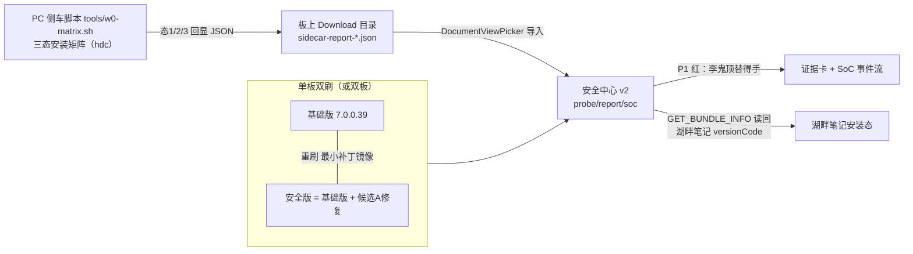
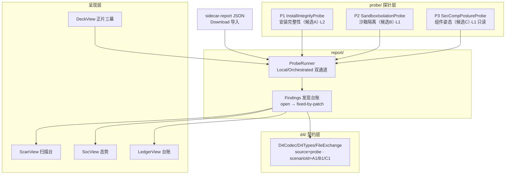

# 安全中心 v2（漏洞自动发掘 agent + 手机系统安全 SoC）架构文档

> v0.1 · 2026-10-14 · 配套总纲：[DEFECT_DEMO_PLAN.md](DEFECT_DEMO_PLAN.md)；姊妹文档：[LAKESIDE_NOTES_ARCH.md](LAKESIDE_NOTES_ARCH.md)。
> 本文是实现级规格：接口签名照抄可用，文件树按行施工。

---

## 1. 定位

安全中心 v2 在老师新叙事里承担三件事：

1. **自动发掘（agent）**：以探针套件主动探测设备与目标应用（湖畔笔记）的风险面，产出红绿结论与证据链——"它能发现湖畔笔记有漏洞点"是验收硬指标；
2. **陪演对照**：在基础版上复现"李鬼顶替湖畔笔记"的得手（红），在安全版上验证同一动作被系统拒绝（绿）——**安全版就是基础版 + 候选 A 最小修复**（appverify 约 10 行 diff，老师明确选最小开销路线）；
3. **态势呈现（SoC）**：手机形态的安全面板——发现计数、证据流、镜像基线、残余声明；纯展示元素显式打标。

工人设纪律与湖畔笔记对称：安全中心**只**对自己板上的探针行为下结论，探针只针对自己的两个 bundle（[DEFECT_DEMO_PLAN.md](DEFECT_DEMO_PLAN.md) §8 边界）。

## 2. 演示拓扑与 W0 依赖



**W0 依赖（施工前置门）**：候选 A 是否在板上成立，由 [DEFECT_DEMO_PLAN.md](DEFECT_DEMO_PLAN.md) §3 三态矩阵一锤定音。本文按"态 2 成功安装"为主线写死 P1 红条件；若板上态 2 被拒，按 §14 降级表执行，P1 规格变体在 §5.4 备好。

**板时钟纪律**：任何带签名验证的演示前后都要 `hdc shell "date -s …"` 对时（板上 RTC 断电会回到 2021，签名时间窗会被击穿），该检查写进 `w0-matrix.sh` 第一步，SocView 镜像基线卡显示当前板时钟。

## 3. 分层架构



## 4. 工程落地（在现有 security-center 工程上重构）

| 项 | 值 |
|---|---|
| 工程 | `/Users/apple/Desktop/openharmony/security-center/`（原工程改造，不新建） |
| bundle | `com.jinyinhu.securitycenter`（不变） |
| label | 金银湖安全中心（不变） |
| 工程基线 | 不动：`compileSdkVersion "26.0.0"` / `compatibleSdkVersion "20"` / `runtimeOS "OpenHarmony"` / modelVersion 6.0.1 / `local.properties` 已有 |
| EntryAbility | 保留现骨架（`security-center/entry/src/main/ets/entryability/EntryAbility.ets`）：深色模式、`LiveStore.bind/restore`、`pages/Index` 加载、屏幕常亮——只把 `LiveStore.prepare()` 里追加 `Findings.restore()` 与 `Registry.registerAll()` |
| 视觉 | 全复用：`common/Theme.ets`、`components/UiParts.ets`（BoardPane 大字红绿卡、EventCard、ScoreRing、TabBar、GoldButton、InfoLine 等已在服役） |
| 权限 | `module.json5` 唯一申请 `ohos.permission.GET_BUNDLE_INFO`（normal 级、system_grant、无弹窗），用途：读回湖畔笔记安装态（§5.2）。picker 走 `DocumentViewPicker`，不需静态权限 |
| 事件存储 | 沿用 LiveStore + preferences/filesDir 模式，新增 findings 数组同库共存 |

## 5. 探针层规格（agent 的核心）

### 5.1 接口（实现者照抄，ArkTS）

```ts
// probe/ProbeTypes.ets
export type Verdict = 'hit' | 'blocked' | 'passive';        // 红 / 绿 / 只读
export type ProofLevel = 'L1' | 'L2' | 'L3';                 // 诚实分级，见 §13

export interface Evidence {
  kind: 'errno' | 'bundle-state' | 'hilog-line' | 'source-ref' | 'cmd-transcript' | 'sidecar-state';
  text: string;      // 一行人类可读（不写数据内容，敏感一律"已脱敏"）
  raw: string;       // errno 十六进制 / 命令回显原文 / file:line
  at: string;        // ISO 时间
}

export interface ProbeResult {
  probeId: 'P1' | 'P2' | 'P3';
  verdict: Verdict;
  phrase: string;            // ≤12 字投屏短句
  level: ProofLevel;
  imageRole: 'base' | 'secure';
  evidences: Evidence[];
  createdAt: string;
}

export interface Probe {
  id: 'P1' | 'P2' | 'P3';
  title: string;
  risk: string;              // 一句话风险描述
  level: ProofLevel;
  run(ctx: common.UIAbilityContext): Promise<ProbeResult>;
}
```

执行通道：

- **LocalProbe**（`run` 内部直接执行，L1）：全部动作在本进程内用公开 API 完成，结果即证据；
- **OrchestratedProbe**（依赖侧车产物，L2）：真执行发生在 PC 侧车脚本（安装器行为只有安装器能给出），本端负责**导入回显 + 读回核验**两步取证。

### 5.2 P1 · InstallIntegrityProbe（安装完整性探针 · 主线）

| 项 | 规格 |
|---|---|
| 对位缺陷 | 候选 A：`~/Desktop/ohos-7.0` `base/security/appverify` `interfaces/innerkits/appverify/src/verify/hap_verify_v2.cpp:1010-1023`（`VerifyProfileSignature` 对命中信任源的包不验 profile 皁名）与 `:960-988`（`VerifyProfileInfo` 证书绑定只在 `DO_NOT_MATCH` 分支执行） |
| 受影响应用 | `com.jinyinhu.lakesidenotes`（湖畔笔记） |
| 执行通道 | OrchestratedProbe / L2 |
| 侧车脚本 | `tools/w0-matrix.sh`（新增，施工于本工程 tools sibling，内容= [DEFECT_DEMO_PLAN.md](DEFECT_DEMO_PLAN.md) §3 三态矩阵 + §3.4 配方），流程：① `date -s` 对时 → ② 态 1 装正身（官方 profile）→ ③ 态 2 装李鬼（伪造 profile）→ ④ `bm dump`/getBundleInfo 核验 versionCode → ⑤ 重装正身清理 → ⑥ 生成 `sidecar-report-<ts>.json` 经 `hdc file send` 落 `/storage/Users/currentUser/Download/` |
| 端内导入 | ScanView → "导入侧车报告" → `new picker.DocumentViewPicker().select({ fileSuffixFilters: ['侧车报告|.json'] })` → picker 返回 URI 后 `fs.open(uri)` 读回 → parse → `Registry.ingestSidecar()`。本 SDK 26 的 `DocumentSelectOptions` 仅有 `defaultFilePathUri`/`fileSuffixFilters`（`@ohos.file.picker.d.ts:420`，since 10），没有 `maxNumber`/`fileSuffixPreferences` |
| 端内读回（取证第二步） | `bundleManager.getBundleInfo('com.jinyinhu.lakesidenotes', DEFAULT)` 抓 `versionCode`：态 2 后变 `1000001` → 李鬼真身入位 → `bundle-state` 证据；恢复态后回 `1000000` |
| 红（hit） | 态 2 `retCode==0`（安装器收下伪造 profile）且读回 versionCode=1000001；phrase 例：「安装器收下了伪造」 |
| 绿（blocked，安全版上） | 态 2 `retCode!=0`（记 errno/错误文案），versionCode 保持 1000000；phrase 例：「安装器拒绝了伪造」 |
| 证据链 | ① `cmd-transcript`：三态命令回显全量；② `sidecar-state`：三态 retCode + 板时钟 + 镜像标签；③ `bundle-state`：读回的 versionCode 变迁；④ `source-ref`：上面两个 file:line。四件齐才判红/绿 |
| 安全纪律 | 侧车只在演示板执行；所有 hap 材料不入 git；态 2 材料只能是 §3.4 工装产物内容（bundle 必须是自己工程包名） |

### 5.3 P2 · SandboxIsolationProbe（沙箱隔离探针 · 备选主线）

| 项 | 规格 |
|---|---|
| 对位缺陷 | 候选 B：`foundation/filemanagement/app_file_service` `interfaces/common/src/sandbox_helper.cpp:532-552`（`IsValidPath` 时序：先校验后 `Decode`，`%2E%2E` 编码穿越逃逸该校验）与 `interfaces/innerkits/native/file_uri/src/file_uri.cpp:154-200`（`GetRealPath` 全程无校验；对照 `:202-219` `GetRealPathBySA` 有校验） |
| 受影响应用 | `com.jinyinhu.lakesidenotes`（其 `filesDir` 私有性即被试契约） |
| 执行通道 | LocalProbe / L1（真实时在本进程） |
| 尝试矩阵（全部只读，逐条记 errno） | ① 明文相对路径：湖畔笔记 `filesDir` 的常见落点路径及其 `../` 变体；② `%2E%2E%2F` 编码路径变体；③ `file://docs/…` 外部存储 URI；④ `file://com.jinyinhu.lakesidenotes/data/storage/el2/base/…` 跨包 URI；⑤ `file://media/…` 姿态 URI。API 面：`fs.statSync` / `fs.openSync(READ_ONLY)`（传 URI 形式按框架实际支持记录，拒收本身也是证据） |
| 判定 | 预期绿＝每条返回 EACCES/EINVAL/ENOENT/参数错误；任一条拿到 stat/句柄/内容 → hit（红） |
| 边界 | 目标路径仅限自己板、湖畔笔记工程演示数据（[LAKESIDE_NOTES_ARCH.md](LAKESIDE_NOTES_ARCH.md) §6 预置标注数据）；读到的任何内容屏显前先脱敏成"已脱敏"提示——探针用于证明可读性，不真展示疑似隐私 |
| 备注 | 结论依赖板上未拉仓（sandbox_manager）的最终裁决行为，函数返回即事实；W0 若候选 A 落空，本探针升主线 |

### 5.4 P3 · SecCompPostureProbe（安全组件姿态探针 · 只读素材）

| 项 | 规格 |
|---|---|
| 对位缺陷 | 候选 C 三个放行口（`base/security/security_component_manager`）：① `window_info_helper.cpp:168-170`——windowId 含 UIExtension 位时直接跳过覆盖检查（fail-open）；② `sec_comp_entity.cpp:53-78`——点击时间戳只查 5 秒窗且由调用方自报；③ `sec_comp_malicious_apps.cpp`——2026-07-14 起"连续失败 3 次才入恶意名单"（commit `1f86d2d`） |
| 执行通道 | LocalProbe（L1）/ 姿态解读部分 L3 |
| 行为 | 页面内真实渲染一个 PasteButton——ArkUI **内建**安全组件（公开 @since 10，声明位本 SDK `ets/component/paste_button.d.ts`，`@kit ArkUI`；本 SDK 不存在 `@ohos.securityComponent` 模块），仅经其 `onClick(event: PasteButtonCallback)` 回调记录"系统组件在本镜像可注册可回报"（可现实测一次真实点击）；同时出"静态姿态卡"：上列三个 file:line + `sec_comp_service.cpp:163-180`（前台 HAP 门槛，当前唯一硬门槛） |
| verdict | 一律 `passive`——**不做任何绕过尝试**（内部 IPC 从 ArkTS 不可达，主动绕过需 native innerkit，违反展示边界）；卡片只用于解释"为什么值得加固" |
| 用途 | SoC 姿态素材 + 台账残余声明列表；`threatStatus=open`，绝不填 `mitigated`（没修就没修） |

### 5.5 探针注册表

```ts
// probe/Registry.ets —— 形态
export class Registry {
  static all(): Probe[];            // [P1 实例, P2 实例, P3 实例]
  static runOne(p: Probe, ctx: common.UIAbilityContext): Promise<ProbeResult>;
  static runAll(ctx, onEach: (r: ProbeResult) => void): Promise<ProbeResult[]>;  // 一键自动扫描
  static ingestSidecar(text: string): SidecarReport | undefined;   // §10 契约
}
```

## 6. report 层：发现与证据纪律

```ts
// report/Findings.ets —— 形态
export interface Finding {
  findingId: string;      // FND-A1 / FND-B1 / FND-C1（+序号）
  scenarioId: 'A1' | 'B1' | 'C1';
  title: string;
  affectedApp: string;    // 'com.jinyinhu.lakesidenotes' | ''（C1 空串=设备面）
  ruleRef: string;        // §5 各探针 file:line
  patchRef: string;       // 修复点描述（候选A＝安全镜像已含，其余＝open）
  status: 'open' | 'fixed-by-patch';
  registeredAt: string;   // 登记时点（显示必须带，防"现场生成"误读）
  evidenceNo: string;     // ≥3 字符，status 非 open 时必填（照抄 D4 纪律）
}
```

- 状态机：`open`（基础版上红，或被动素材）→ `fixed-by-patch`（安全版上同探针绿；evidenceNo 用当次导出包名+态号+时间哈希缩写）。
- **"已修复"的认定依据只认一条**：同一个探针在安全镜像上的绿证据（retCode/errno 事实），推断链固定为"红→镜像补丁→绿"，页面上把补丁 file:line 与镜像标签并排展示。
- 纪律：`fixed-by-patch` 永远由绿证据自动生成，不允许手填成"已修复"；`passive` 探针产生的条目永远 `open`。

## 7. soc 层：态势面板

| 组件 | 内容 | 数据来源 | 分级 |
|---|---|---|---|
| 态势环 | 红（hit）/绿（blocked）/灰（passive）计数环 + "发现/探针" 大数 | ProbeResult | L1/L2 |
| 事件流 | FindingCards 时间倒序流，右侧彩色竖条（红/绿/金） | Findings | L1/L2 |
| 镜像基线卡 | `@ohos.deviceInfo.osFullName`、板当前时钟、镜像标签（base/secure，来自侧车报告或手动选择）、基础版 vs 安全版补丁行号 | 设备真值 + 侧车 | L1/L2 |
| 残余声明卡 | 固定文案（"台账未收口项保持 open……"）+ open 条目数 | Findings | L1 |
| 展示区（L3） | 终端分布/攻击面示意图（静态插画 + 占位数），空载面板"演示前无事件"占位 | 无真实数据，必须冠"展示"角标 | L3 |

## 8. deck 层：正片三幕

复用既有全屏正片作风（`BoardPane` 红绿大字卡 + 计时条 + 讲解词），由 `DeckScript.ets` 编排：

| 幕 | 画面与动作 | 讲解词要点 | 时长 |
|---|---|---|---|
| 一 · 湖畔笔记上线 | 真机切湖畔笔记，存"门锁重置码"笔记；正片卡显示"普通软件·正常存储" | "先有一个普通软件，它依赖两条系统承诺" | 30s |
| 二 · 得手（基础版） | 一键自动扫描：P1 红——导入侧车态 2 + versionCode 读回；卡面红字"得手"，附李鬼 TrophyView 同屏照片位 | "安全中心把伪装的安装请求递给系统，基础版收下了它，笔记已在别人手里" | 60s |
| 三 · 不可利用（安全版） | 换安全镜像（基础版+候选A修复）后同操作：P1 绿字"阻断"，出补丁行号并排（hap_verify_v2.cpp:1010-1023 一线） | "系统修了安装验签这一处，湖畔笔记一行没改——现在不可被利用" | 60s |

- 幕间与结局各 15s 边界声明（沿既有口径："覆盖的是台账中登记的线，不是装了就百毒不侵"）。
- 收尾归档：Findings → D4 导出（§9）。
- DeckChecklist（正片前强制）：板对时 / 湖畔笔记预置数据 reset / 侧车脚本已出最新报告 / 空载占位页面清理。

## 9. d4 契约扩展（给实现者的精确 diff）

对 [contracts/d4-event.schema.json](contracts/d4-event.schema.json) **只加枚举，不动版本号**（`schemaVersion` 保持 `"0.1"`，加法不破坏解码）：

```diff
- "imageRole": { "enum": ["vanilla-demo", "secure"] }
+ "imageRole": { "enum": ["vanilla-demo", "secure", "base"] }

- "scenarioId": { "enum": ["S1", "S2", "S3", "D3"] }
+ "scenarioId": { "enum": ["S1", "S2", "S3", "D3", "A1", "B1", "C1"] }

- "source": { "enum": ["onsite", "rehearsal", "imported", "show"] }
+ "source": { "enum": ["onsite", "rehearsal", "imported", "show", "probe"] }
```

语义映射（写进 `D4Types.ets` 的 label 表）：

| 枚举 | 含义 | 使用约定 |
|---|---|---|
| `imageRole: base` | 基础版镜像（7.0.0.39 之拍照标签） | 新事件一律用它；历史数据 `vanilla-demo` 兼容不迁移 |
| `scenarioId: A1` | 安装信任链（候选 A） | P1 产出，outcome 用 succeeded/blocked |
| `scenarioId: B1` | 沙箱隔离（候选 B） | P2 产出，同上 |
| `scenarioId: C1` | 安全组件姿态（候选 C） | P3 passive，**不产生 D4 事件**（无红绿事实），只入本地台账 |

同步落地 [tools/check_contract.py](tools/check_contract.py) 三行（顶部 set 常量）：`ROLES` 加 `"base"`、`SCENARIOS` 加 `{"A1","B1","C1"}`、`SOURCES` 加 `"probe"`。D4Codec/D4Types 的短句枚举、状态枚举沿现有实现（`threatStatus` 继续只用 open/residual/mitigated；本工程实际只会产生 open 与 fixed-by-patch 的展示映射——后者仅前端状态，写文件时映射回 `mitigated` 时必须同时落 `registeredAt` 与 `evidenceNo`，纪律同旧版）。

## 10. 侧车协议（OrchestratedProbe 的输入契约）

`w0-matrix.sh` 产出文件（发板 Download）：

```json
{
  "schema": "jinyinhu.sidecar.report",
  "schemaVersion": "0.1",
  "imageTag": "base|secure",
  "boardUdid": "B05FC428…",
  "boardClockAtRun": "2026-10-14T22:41:00+08:00",
  "matrix": [
    {
      "state": 1,
      "desc": "官方签名+官方profile 正身",
      "cmd": "hdc install -r lakeside-notes-normal-signed.hap",
      "retCode": 0,
      "transcript": "install bundle successfully",
      "at": "…"
    },
    { "state": 2, "desc": "官方签名+伪造profile 李鬼", "cmd": "hdc install -r lakeside-notes-doppel.hap", "retCode": 0, "transcript": "…", "at": "…" },
    { "state": 3, "desc": "自签链+伪造profile 对照", "retCode": -1, "transcript": "…", "at": "…" }
  ]
}
```

`Registry.ingestSidecar()` 校验：schema 常量、UDID 与准备页登记值一致或留空跳过——本板 UDID 由演示员 `hdc shell bm get -u` 取回手工登记（本 SDK 的 `@ohos.deviceInfo` **没有 `udi` 字段**，不可编程读取）、`matrix` 至少含态 2。校验失败给 P1 打**导入失败**态（不装样子判红）。

## 11. 页面与组件

`pages/Index.ets` 骨架：全屏正片模式（默认开，进入即第三幕能预演）+ 底部"准备"切换 —— 沿用 `contrast-console/entry/src/main/ets/pages/Index.ets` 的 `showMode` 模式。准备模式五 tab：

| 页 | 职责 | 复用/新增 |
|---|---|---|
| 正片（DeckView，默认） | §8 三幕 | 新建，复用 BoardPane/ShowDock 大作风 |
| 扫描（ScanView） | P1/P2/P3 三卡 + "一键自动扫描" + 导入侧车报告 + 每探针红绿短语、L1/L2/L3 角标 | 新建 |
| 台账（LedgerView） | FindingCards + 状态机 + 登记时点/依据编号列 | 新建，复用 EventCard 的卡式 |
| SoC（SocView） | §7 四块面板 + L3 展示区 | 新建，复用 ScoreRing/InfoLine |
| 归档（ArchiveView） | D4 导入导出（沿 FileExchange）+ 现有 `jinyinhu-d4-events.json` 文件名 | 保留改造，加 sidecar picker 入口 |

新增组件：`FindingCard`（红绿左侧条 + 登记时点必示）、`ProbeBadge`（P1/P2/P3 + L 角标）、`DemoBadge`（"展示"角标，L3 专用）。

## 12. 施工清单（文件树）

```
security-center/entry/src/main/ets/
├── entryability/EntryAbility.ets        # 保留骨架；onCreate 追加 Findings.restore()
├── common/Theme.ets                     # 保留
├── components/UiParts.ets               # 保留 + 新增 FindingCard/ProbeBadge/DemoBadge
├── probe/
│   ├── ProbeTypes.ets                   # §5.1 照抄
│   ├── Registry.ets                     # §5.5 照抄
│   ├── InstallIntegrityProbe.ets       # P1（§5.2）
│   ├── SandboxIsolationProbe.ets        # P2（§5.3）
│   └── SecCompPostureProbe.ets          # P3（§5.4）
├── report/
│   ├── Findings.ets                     # §6；持久化进 LiveStore
│   └── Ledger.ets                       # 台账读写/导出动线
├── model/
│   ├── D4Types.ets · D4Codec.ets        # 枚举扩展（§9 三处）
│   ├── FileExchange.ets                 # picker 入口 + 原导出保留
│   └── LiveStore.ets                    # 增 findings 槽位
├── deck/DeckScript.ets                  # §8 三幕编排
└── pages/
    ├── Index.ets                        # 改造：showMode + 五 tab
    ├── DeckView.ets                     # 新建（取代 SecurityShowView）
    ├── ScanView.ets                     # 新建
    ├── LedgerView.ets                   # 新建
    ├── SocView.ets                      # 新建
    └── ArchiveView.ets                  # 改造
tools/w0-matrix.sh                        # 新增（PC 侧）；配方=[DEFECT_DEMO_PLAN §3+§3.4]
```

删除（素材回收到 contrast-console 或文档，不保留死代码）：`OverviewView`、`StreamView`、`BaselineView`、`SecurityShowView`、`Catalog` 中旧场景态记录表（`S1/S2/D3` 台账活线由新 Findings 承接）。

施工顺序建议：① ProbeTypes/Registry + ScanView 的 P2（纯端内、依赖最少）→ ② Findings + LedgerView/SocView → ③ sidecar 脚本 + P1 → ④ DeckView 三幕 → ⑤ D4 扩展与 ArchiveView。

## 13. 诚实分级（全站纪律，演示与导出都带）

| 级 | 定义 | 谁在执行 |
|---|---|---|
| L1 | 端内真实时，API 返回即事实 | P2、P3 的组件可用性部分 |
| L2 | 侧车真执行 + 端内读回取证 | P1 |
| L3 | 纯展示元素（插画、示意数） | SoC 展示区；无角标时不出现 |

规则：判红/判绿必须是 L1 或 L2；`passive` 条目永不判红；导出的 D4 事件 `source` 一律 `probe`（隐患条目不是"现场观察"）。

## 14. 验收判据与风险降级

验收（对齐 [DEFECT_DEMO_PLAN.md](DEFECT_DEMO_PLAN.md) §6，安全中心侧的三条硬线）：

| # | 判据 |
|---|---|
| 1 | 基础版：P1 判红且四件证据齐（transcript/sidecar-state/bundle-state/source-ref），湖畔笔记被点名 |
| 2 | 安全版：P1 判绿，同一 hap、同一命令序列，补丁行号并排出示 |
| 3 | 台账/导出：Finding 状态机与 D4 枚举扩展落地，`fixed-by-patch` 自动带 registeredAt+evidenceNo |
| 4 | SoC 空载页面无穿帮；所有 L3 区带"展示"角标 |

降级顺序（W0 结果驱动）：

1. 态 2 装上 → 主线即候选 A（本规格 P1 全照走）；
2. 态 2 被拒 → P1 转"披露态"（L3：只演示侧车与结论陈述，判红取消），主线升 P2（候选 B），正片第二幕改演沙箱读；台账 A1 相关条目改 `open`＋备注"基础版已由后续镜像修复验证"；
3. P2 也无红 → 主线转"姿态披露版"（P3 素材 + 录屏兜底），叙事降级为"解读当前放行条件 + 边界声明"，不虚构红绿。

> 施工注意：本工程所有真机安装实验仍受 [DEFECT_DEMO_PLAN.md](DEFECT_DEMO_PLAN.md) §8 不武器化边界约束——目标是自己的板、bundle 是自己的两个工程、素材不入 git、屏显脱敏。

## 15. OpenHarmony 环境符合性审查记录（2026-10-15）

对照本机 OpenHarmony SDK（`/Users/apple/Library/OpenHarmony/Sdk/26.0.0`）、`~/Desktop/ohos-7.0`（`OpenHarmony-7.0-Release` 七仓）与真机（HH-SCDAYU200 · 7.0.0.39 · API 26）逐项核对结果：

| 文档断言 | 环境事实 | 结论 |
|---|---|---|
| 工程基线 `"26.0.0"`/`"20"`/`runtimeOS OpenHarmony` 字符串形式 | 两个 app 已按此在板上编译、安装成功（本仓实战记录） | 通过 |
| 唯一权限 `GET_BUNDLE_INFO`：normal / system_grant / 无弹窗 | `~/Desktop/ohos-7.0/base/security/access_token/services/accesstokenmanager/permission_definitions.json:230`：`system_grant` + `availableLevel: normal` + since 7 | 通过 |
| `bundleManager.getBundleInfo(bundleName, DEFAULT)` 读他包 | SDK `@ohos.bundle.bundleManager.d.ts:1048` 注记 `@permission ohos.permission.GET_BUNDLE_INFO_PRIVILEGED or ohos.permission.GET_BUNDLE_INFO` | 通过 |
| picker 导入侧车 JSON | SDK `@ohos.file.picker.d.ts:420` `DocumentSelectOptions` 仅 `defaultFilePathUri`/`fileSuffixFilters`（since 10）；原稿示例的 `fileSuffixPreferences`/`maxNumber` **不存在于本 SDK** | 已修正 §5.2 |
| fs 以路径/URI 取证（P2 全部尝试） | SDK `@ohos.file.fs.d.ts:1694` 路径参数注释 "Application sandbox path or URI"，URI 形态该 API 自 22 起可传（本板 API 26 覆盖） | 通过 |
| 镜像基线卡读 `deviceInfo.osFullName` | SDK `@ohos.deviceInfo.d.ts:310` 公开 const `@since 6`，无权限要求 | 通过 |
| ~~`deviceInfo.udi` 比对侧车 UDID~~ | `@ohos.deviceInfo.d.ts` **无 `udi` 字段** | 已修正 §10（登记式：`hdc shell bm get -u` 手工登记） |
| P3 渲染 PasteButton | 内建组件 `ets/component/paste_button.d.ts`（`@kit ArkUI`，公开 since 10，回调 `onClick(event: PasteButtonCallback)`）；**本 SDK 无 `@ohos.securityComponent` 模块**（HarmonyOS 叫法不适用于本工程） | 已修正 §5.4 措辞 |
| `hdc file send` 落 `/storage/Users/currentUser/Download/` 且 picker 可见 | 板今日未连接，未实测 | **待板复核**（W0 一并验；失败则改 `hdc shell` 直写后由演示员经文件管理器/指定 URI 通道导入，§10 契约不变） |
| 板上 filepicker 应用预装（picker 能拉起） | 标准 OH 发行镜像默认含；本板未复验 | 待板复核 |

> 结论：两份架构文档除上表三处 API 名（picker 选项、udi、安全组件模块形态）已按 OpenHarmony SDK 26 实况修正外，其余环境断言全部成立；两个"待板复核"项随 W0 三态矩阵一并验证，不阻塞施工。